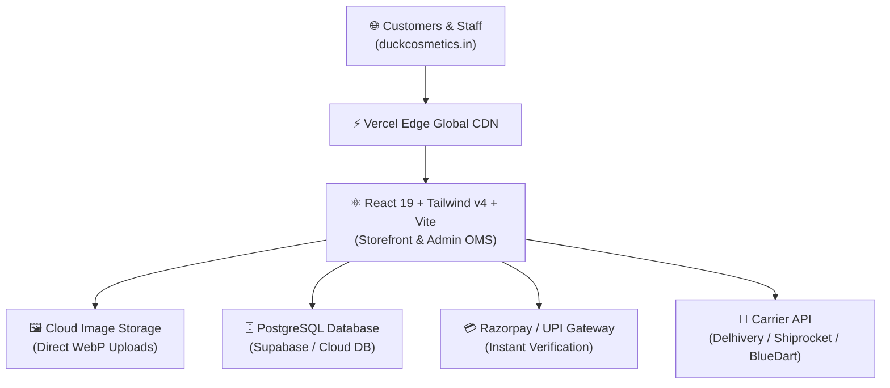

# 🚀 Duck Cosmetics — Complete Production Deployment Guide (Vercel & Cloud Backend)

This guide walks you step-by-step through deploying the **Duck Cosmetics E-commerce Storefront & Admin OMS Dashboard** live to **Vercel** with a connected cloud database, image storage, payment gateway, and custom domain (`duckcosmetics.in`).

---

## 📋 Table of Contents
1. [Architecture Overview](#1-architecture-overview)
2. [Step 1: Cloud Database Setup (Supabase / PostgreSQL)](#2-step-1-cloud-database-setup-supabase--postgresql)
3. [Step 2: Cloud Image Storage Setup](#3-step-2-cloud-image-storage-setup)
4. [Step 3: Push Project to GitHub](#4-step-3-push-project-to-github)
5. [Step 4: Deploy to Vercel](#5-step-4-deploy-to-vercel)
6. [Step 5: Connect Custom Domain (e.g. duckcosmetics.in)](#6-step-5-connect-custom-domain)
7. [Step 6: Payment Gateway Setup (Razorpay / PhonePe)](#7-step-6-payment-gateway-setup-razorpay--phonepe)
8. [Step 7: Courier & Shipping API (Delhivery / Shiprocket)](#8-step-7-courier--shipping-api)
9. [Step 8: Admin Security & Staff Login in Production](#9-step-8-admin-security--staff-login-in-production)
10. [Pre-Launch Checklist](#10-pre-launch-checklist)

---

## 1. Architecture Overview



* **Frontend & Admin OMS**: Single high-performance SPA built with Vite, React 19, and Tailwind CSS v4.
* **Hosting**: Vercel (Edge network, global CDN, automatic SSL/HTTPS).
* **Database**: Supabase / PostgreSQL (handles orders, products, inventory reservations, customers, staff, audit logs).
* **Media Storage**: Supabase Storage / Cloudinary (for direct product image uploads).

---

## 2. Step 1: Cloud Database Setup (Supabase / PostgreSQL)

We recommend **Supabase** because it provides a dedicated PostgreSQL database, automated REST API, built-in Authentication, and Cloud Image Storage in one unified dashboard with a generous free tier.

### 1.1 Create your Database
1. Go to [https://supabase.com](https://supabase.com) and click **"Start your project"**.
2. Sign up or log in with GitHub/Google.
3. Click **"New Project"**:
   - **Name**: `duck-cosmetics-prod`
   - **Database Password**: Set a strong password and save it securely.
   - **Region**: Select **India (Mumbai) - `ap-south-1`** for the lowest customer latency.
   - **Plan**: Free tier (or Pro).
4. Click **Create new project** (takes ~1-2 minutes).

### 1.2 Run SQL Database Migration Script
In your Supabase dashboard, click **SQL Editor** in the left menu, paste the following SQL script, and click **Run**:

```sql
-- 1. Products Table
CREATE TABLE IF NOT EXISTS products (
    id TEXT PRIMARY KEY,
    name TEXT NOT NULL,
    category TEXT NOT NULL,
    sku TEXT UNIQUE NOT NULL,
    detail TEXT,
    mrp NUMERIC NOT NULL,
    price NUMERIC NOT NULL,
    cost_price NUMERIC DEFAULT 0,
    stock INTEGER NOT NULL DEFAULT 0,
    reserved_stock INTEGER DEFAULT 0,
    low_stock_threshold INTEGER DEFAULT 10,
    hsn_code TEXT DEFAULT '33049910',
    gst_rate NUMERIC DEFAULT 18,
    image TEXT NOT NULL,
    badge TEXT,
    status TEXT DEFAULT 'Active',
    created_at TIMESTAMPTZ DEFAULT NOW(),
    updated_at TIMESTAMPTZ DEFAULT NOW()
);

-- 2. Orders Table
CREATE TABLE IF NOT EXISTS orders (
    id TEXT PRIMARY KEY,
    order_number TEXT UNIQUE NOT NULL,
    customer_id TEXT,
    customer_name TEXT NOT NULL,
    customer_email TEXT NOT NULL,
    customer_phone TEXT NOT NULL,
    shipping_address JSONB NOT NULL,
    billing_address JSONB,
    items JSONB NOT NULL,
    subtotal NUMERIC NOT NULL,
    discount_total NUMERIC DEFAULT 0,
    shipping_fee NUMERIC DEFAULT 0,
    tax_total NUMERIC DEFAULT 0,
    cgst NUMERIC DEFAULT 0,
    sgst NUMERIC DEFAULT 0,
    igst NUMERIC DEFAULT 0,
    grand_total NUMERIC NOT NULL,
    amount_paid NUMERIC DEFAULT 0,
    amount_due NUMERIC DEFAULT 0,
    payment_method TEXT NOT NULL,
    payment_status TEXT NOT NULL,
    payment_transaction_ref TEXT,
    order_status TEXT NOT NULL,
    shipping_status TEXT NOT NULL,
    shipping_provider TEXT,
    tracking_number TEXT,
    tracking_url TEXT,
    assigned_staff_id TEXT,
    assigned_staff_name TEXT,
    assigned_staff_role TEXT,
    customer_notes TEXT,
    packing_notes TEXT,
    internal_staff_notes TEXT,
    invoice_number TEXT,
    timeline JSONB DEFAULT '[]'::jsonb,
    created_at TIMESTAMPTZ DEFAULT NOW(),
    updated_at TIMESTAMPTZ DEFAULT NOW()
);

-- 3. Shipments Table
CREATE TABLE IF NOT EXISTS shipments (
    id TEXT PRIMARY KEY,
    shipment_number TEXT UNIQUE NOT NULL,
    order_id TEXT REFERENCES orders(id),
    order_number TEXT NOT NULL,
    customer_name TEXT NOT NULL,
    carrier TEXT NOT NULL,
    tracking_number TEXT NOT NULL,
    tracking_url TEXT,
    status TEXT NOT NULL,
    shipping_address JSONB NOT NULL,
    dispatched_at TIMESTAMPTZ,
    delivered_at TIMESTAMPTZ,
    failed_attempts INTEGER DEFAULT 0,
    created_at TIMESTAMPTZ DEFAULT NOW()
);

-- 4. Payment Transactions Ledger
CREATE TABLE IF NOT EXISTS transactions (
    id TEXT PRIMARY KEY,
    transaction_ref TEXT UNIQUE NOT NULL,
    order_id TEXT REFERENCES orders(id),
    order_number TEXT NOT NULL,
    customer_name TEXT NOT NULL,
    method TEXT NOT NULL,
    type TEXT NOT NULL,
    amount NUMERIC NOT NULL,
    status TEXT NOT NULL,
    verified_at TIMESTAMPTZ,
    notes TEXT,
    recorded_by TEXT,
    created_at TIMESTAMPTZ DEFAULT NOW()
);

-- 5. Return Requests Table
CREATE TABLE IF NOT EXISTS return_requests (
    id TEXT PRIMARY KEY,
    request_number TEXT UNIQUE NOT NULL,
    order_id TEXT REFERENCES orders(id),
    order_number TEXT NOT NULL,
    customer_id TEXT,
    customer_name TEXT NOT NULL,
    customer_email TEXT NOT NULL,
    customer_phone TEXT NOT NULL,
    items JSONB NOT NULL,
    reason TEXT NOT NULL,
    customer_comments TEXT,
    status TEXT NOT NULL,
    received_condition TEXT,
    restocking_decision TEXT,
    refund_amount NUMERIC NOT NULL,
    refund_status TEXT NOT NULL,
    processed_by TEXT,
    created_at TIMESTAMPTZ DEFAULT NOW(),
    updated_at TIMESTAMPTZ DEFAULT NOW()
);

-- 6. Customer Support Tickets Table
CREATE TABLE IF NOT EXISTS support_tickets (
    id TEXT PRIMARY KEY,
    ticket_number TEXT UNIQUE NOT NULL,
    customer_name TEXT NOT NULL,
    customer_email TEXT NOT NULL,
    customer_phone TEXT NOT NULL,
    order_number TEXT,
    subject TEXT NOT NULL,
    category TEXT NOT NULL,
    priority TEXT NOT NULL,
    status TEXT NOT NULL,
    assigned_to TEXT,
    messages JSONB DEFAULT '[]'::jsonb,
    created_at TIMESTAMPTZ DEFAULT NOW(),
    updated_at TIMESTAMPTZ DEFAULT NOW()
);

-- 7. Immutable Security Audit Log
CREATE TABLE IF NOT EXISTS audit_logs (
    id TEXT PRIMARY KEY,
    timestamp TIMESTAMPTZ DEFAULT NOW(),
    staff_id TEXT NOT NULL,
    staff_name TEXT NOT NULL,
    staff_role TEXT NOT NULL,
    action TEXT NOT NULL,
    module TEXT NOT NULL,
    target_id TEXT,
    details TEXT NOT NULL
);
```

### 1.3 Obtain API Credentials
1. In your Supabase project, go to **Settings (Gear icon)** $\rightarrow$ **API**.
2. Copy the following:
   * **Project URL**: `https://xxxxxxxxxxxx.supabase.co`
   * **Project API Keys**: Copy the `anon` `public` key and the `service_role` `secret` key.

---

## 3. Step 2: Cloud Image Storage Setup

To allow staff to upload product images directly from their device:
1. In your Supabase Dashboard, click **Storage** in the left menu.
2. Click **"New bucket"**:
   - **Bucket Name**: `duck-product-images`
   - Toggle **"Public bucket"** to **ON** (so product photos are viewable by shoppers).
   - Click **Save bucket**.
3. Under **Policies**, ensure `SELECT` (read) is public for everyone, and `INSERT / UPDATE` is allowed for authenticated staff.

---

## 4. Step 3: Push Project to GitHub

1. Initialize git in your local project directory:
   ```bash
   git init
   git add .
   git commit -m "Initial commit of Duck Cosmetics Storefront and Admin OMS"
   ```
2. Create a new repository on [GitHub](https://github.com/new) named `duck-cosmetics-website` (select **Private** to protect your business code).
3. Push your repository:
   ```bash
   git remote add origin https://github.com/YOUR_USERNAME/duck-cosmetics-website.git
   git branch -M main
   git push -u origin main
   ```

---

## 5. Step 4: Deploy to Vercel

1. Log in to [https://vercel.com](https://vercel.com) (sign in with your GitHub account).
2. Click **"Add New..."** $\rightarrow$ **"Project"**.
3. Find your `duck-cosmetics-website` repository and click **Import**.
4. Configure the project:
   - **Framework Preset**: `Vite` (Vercel automatically detects this).
   - **Root Directory**: `./`
   - **Build Command**: `npm run build`
   - **Output Directory**: `dist`
5. Expand **Environment Variables** and add the keys from your `.env.example`:

| Variable Name | Example Value | Description |
|---|---|---|
| `VITE_SUPABASE_URL` | `https://xyz.supabase.co` | Your Supabase Project URL |
| `VITE_SUPABASE_ANON_KEY` | `eyJhbGciOi...` | Supabase Public Anon Key |
| `VITE_PUBLIC_STORE_URL` | `https://duckcosmetics.in` | Live production website URL |
| `VITE_RAZORPAY_KEY_ID` | `rzp_live_xxxxxxxx` | Live Payment Key ID |

6. Click **Deploy**.
7. In under 60 seconds, your site will be live at `https://duck-cosmetics-website.vercel.app`!

---

## 6. Step 5: Connect Custom Domain

To connect `duckcosmetics.in` to your Vercel deployment:
1. In your Vercel Project Dashboard, go to **Settings** $\rightarrow$ **Domains**.
2. Enter your domain: `duckcosmetics.in` and click **Add**.
3. Vercel will ask you to add `www.duckcosmetics.in` as an automatic redirect. Click **Add**.
4. Log into your domain registrar (GoDaddy, Namecheap, Hostinger, etc.) and update your DNS records:
   - **Type A**:
     - Name: `@`
     - Value: `76.76.21.21`
   - **Type CNAME**:
     - Name: `www`
     - Value: `cname.vercel-dns.com`
5. Vercel automatically issues a free, auto-renewing **SSL/TLS Certificate (HTTPS)** within 15 minutes.

---

## 7. Step 6: Payment Gateway Setup (Razorpay / PhonePe)

### 7.1 Razorpay Setup
1. Create an account at [https://razorpay.com](https://razorpay.com) and complete business KYC for Duck Cosmetics.
2. Go to **Settings** $\rightarrow$ **API Keys** $\rightarrow$ Click **Generate Live Key**.
3. Copy your `Key ID` and `Key Secret`.
4. Enable payment methods: **UPI (Google Pay, PhonePe, Paytm)**, **Debit/Credit Cards**, **NetBanking**, and **Cash on Delivery (COD)**.
5. In **Admin OMS** $\rightarrow$ **17. Website Settings**, save your Razorpay Key ID.

---

## 8. Step 7: Courier & Shipping API

### 8.1 Delhivery One / Shiprocket Integration
1. Register on [https://one.delhivery.com](https://one.delhivery.com) or [https://shiprocket.in](https://shiprocket.in).
2. Generate an API Token under Developer Settings.
3. In **Admin OMS** $\rightarrow$ **6. Shipping & Delivery**:
   - Selected carrier integration automatically generates AWBs, tracking links, and synchronized delivery scans.
   - For manual dispatch, enter carrier names and AWBs directly.

---

## 9. Step 8: Admin Security & Staff Login in Production

In production, regular shoppers will never see or access the Admin OMS:

1. **Hidden Public Header**: The purple "Admin Dashboard" button is hidden in production mode.
2. **Dedicated Staff Route**: Authorized staff access the dashboard via:
   - URL: `https://duckcosmetics.in/#admin` or `https://duckcosmetics.in/admin`
   - Discreet "Staff Portal" link in the footer.
3. **Staff Login Authentication**:
   - Access requires employee credentials.
   - Granular RBAC ensures that staff members only see permitted modules:
     - *Shipping Staff* only access logistics, dispatches, and labels.
     - *Packing Staff* only access packing queues and packing slips.
     - *Finance Staff* handle COD reconciliation and refunds.
     - Customer sensitive data (phone and email) is masked for unauthorized roles.

---

## 10. Pre-Launch Checklist

Before announcing Duck Cosmetics to the public:

- [ ] **Catalog Verification**: Verify that all 10 products have accurate selling prices, MRPs, HSN codes, and GST rates.
- [ ] **Image Upload Test**: Upload crisp product photos in Admin Module 3 and confirm they display cleanly on desktop and mobile.
- [ ] **Tax Configuration**: Confirm Gujarat GST (CGST + SGST) vs Inter-State (IGST) is calculated accurately.
- [ ] **Test Checkout**: Place a live ₹1 test transaction using UPI to confirm payment gateway callback and invoice generation.
- [ ] **COD Workflow**: Test a COD order, dispatch it with a carrier tracking number, and simulate cash collection reconciliation.
- [ ] **Invoice Legal Details**: Verify that legal entity name, GSTIN (`24AAACD1234F1Z8`), and PAN are configured in Website Settings.
- [ ] **Serviceable PIN Codes**: Confirm that your target delivery PIN codes are listed in the delivery checker.
- [ ] **Policies Published**: Ensure Shipping, Returns, Privacy, and Terms policies match your operational standards.

---

🎉 **Congratulations! Your Duck Cosmetics e-commerce platform and complete Order Management System are ready for live production!**
